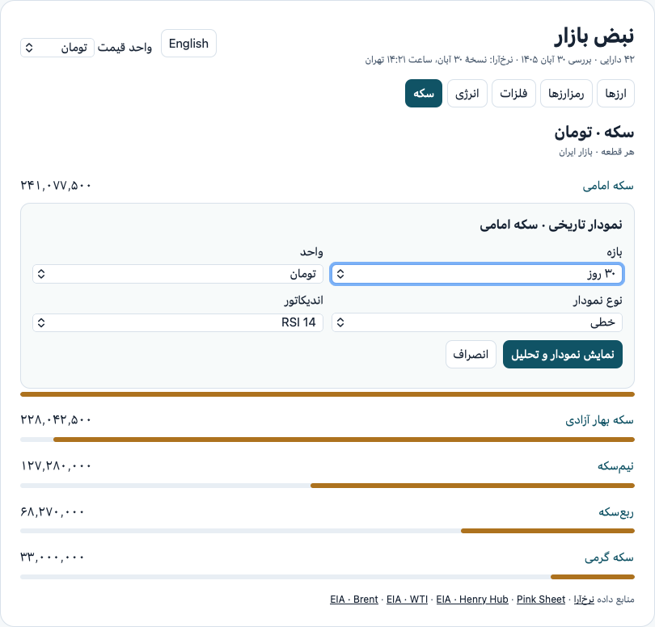
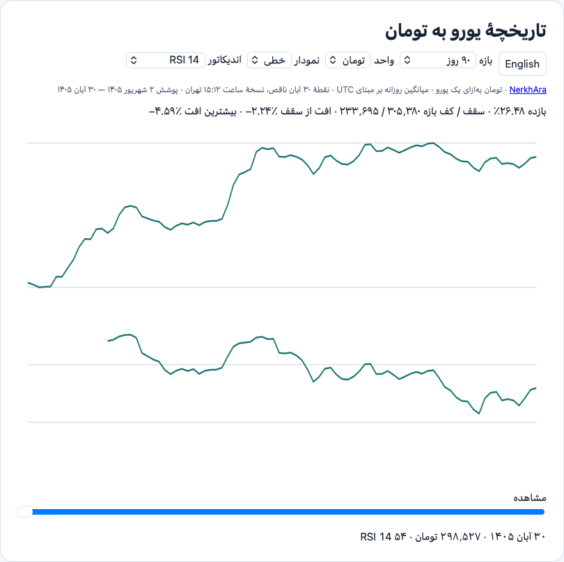
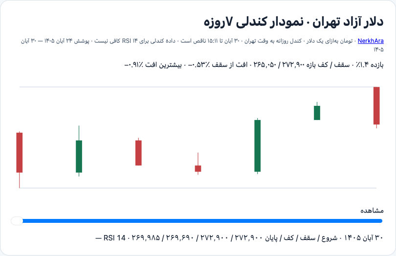
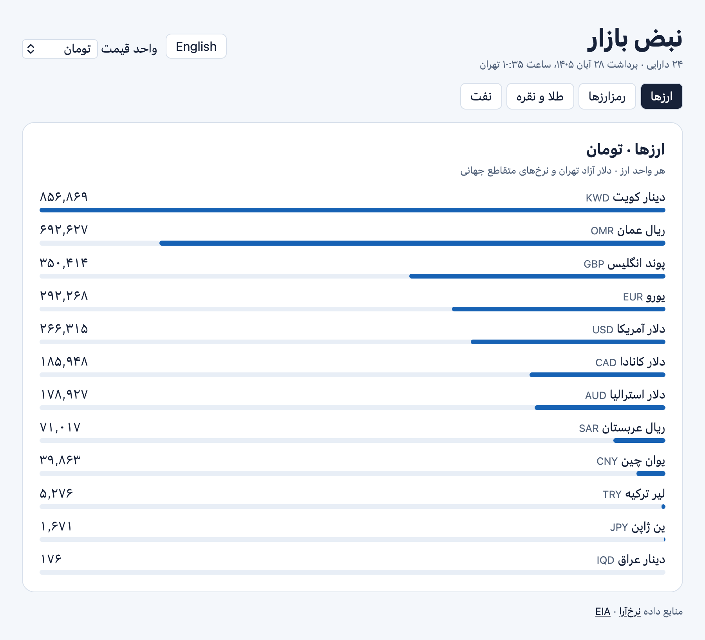
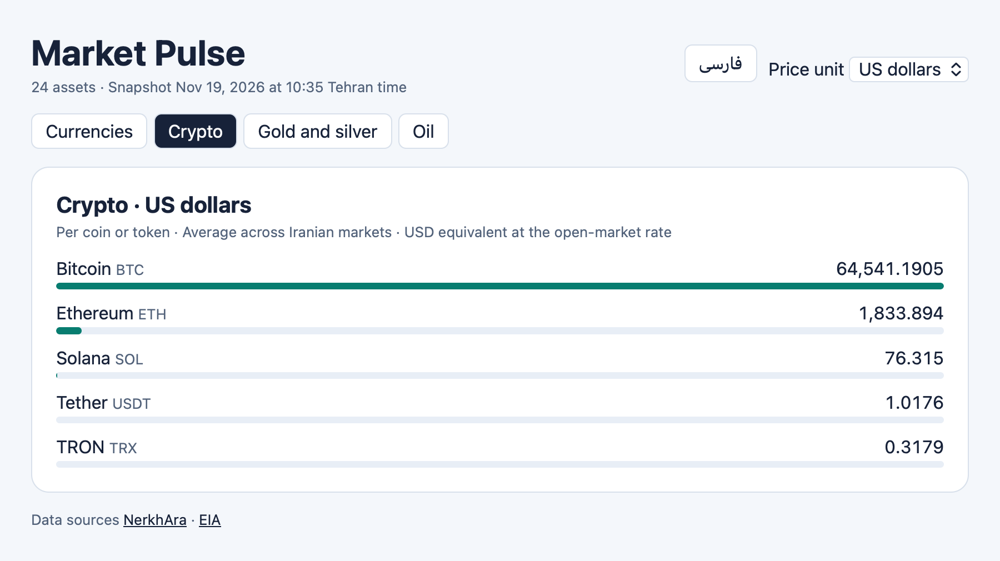

# کدکس چند | Codex Chand

**نرخ‌های بازار تهران، نمودارهای تاریخی و تحلیل تکنیکال به فارسی و انگلیسی**

برای دیدن داشبورد ۶۰ ردیفی، `$codex-chand` را اجرا کن. با افزودن نام دارایی، قیمت آن را در یک خط بگیر و با افزودن بازهٔ زمانی، تاریخچهٔ قیمت را ببین. در صورت پوشش منابع، قیمت‌ها به تومان و دلار آمریکا نمایش داده می‌شوند.

[English](README.md) · [نصب](#نصب) · [استفاده](#استفاده) · [نمودارهای تاریخی](#نمودارهای-تاریخی) · [دارایی‌های پشتیبانی‌شده](#داراییهای-پشتیبانیشده)

## تصاویر محیط کار

### از قیمت تا نمودار

روی نام دارایی بزن تا تنظیمات نمودار باز شوند. در این نمونه، بازهٔ ۳۰ روزه و RSI ۱۴ برای سکهٔ امامی انتخاب شده‌اند.



### تاریخچهٔ قیمت

| نمودار تعاملی قیمت و RSI | نمودار کندلی هفت‌روزه |
| --- | --- |
|  |  |
| درخواست مستقیم نمودار با امکان انتخاب بازه و اندیکاتور | نتیجهٔ درخواست از داشبورد با تنظیمات انتخاب‌شده |

### نماهای داشبورد

| فارسی · نرخ ارز به تومان | انگلیسی · رمزارز به دلار آمریکا |
| --- | --- |
|  |  |

نماهای داشبورد از نمونهٔ ۲۸ آبان ۱۴۰۵ استفاده می‌کنند. تصاویر فرم و نمودارهای تاریخی در ۳۰ آبان ۱۴۰۵ از مهارت نصب‌شده گرفته شده‌اند.

## نصب

مخزن را در پوشهٔ مهارت‌های کدکس کلون کن.

```sh
mkdir -p ~/.codex/skills
git clone https://github.com/prp-e/codex-chand.git ~/.codex/skills/codex-chand
```

اگر از قبل پوشهٔ `codex-chand` را داری، پیش از به‌روزرسانی نسخهٔ محلی را بررسی کن یا از آن نسخهٔ پشتیبان بگیر. یادداشت‌های منابع و پوشهٔ `assets` را کنار `SKILL.md` نگه دار تا پیوندهای نسبی مهارت کار کنند. اگر مهارت فوراً در فهرست کدکس ظاهر نشد، نشست را دوباره راه‌اندازی کن.

## استفاده

| درخواست | نتیجه |
| --- | --- |
| `$codex-chand` | داشبورد کامل دوزبانه با فارسی و تومان به‌عنوان پیش‌فرض |
| `$codex-chand USD` | قیمت یک دلار آمریکا در بازار آزاد تهران به تومان |
| `$codex-chand BTC` | قیمت یک بیت‌کوین به تومان و دلار آمریکا |
| `$codex-chand طلای ۱۸ عیار` | قیمت هر گرم طلای ۱۸ عیار ایران به تومان و دلار آمریکا |
| `$codex-chand سکه امامی` | قیمت هر قطعه سکهٔ امامی به تومان و دلار آمریکا |
| `$codex-chand Brent` | قیمت نقدی هر بشکه نفت برنت با تاریخ مشاهده در صورت تأخیر |
| `$codex-chand بیت‌کوین، ۱۸۰ روز اخیر به تومان، با RSI` | تاریخچهٔ قیمت بیت‌کوین به تومان با RSI فعال |

پاسخ تک‌دارایی به زبان درخواست است. در داشبورد می‌توانی بین فارسی و انگلیسی و بین تومان و دلار آمریکا جابه‌جا شوی. تغییر زبان، برچسب‌ها، تاریخ، قالب اعداد و جهت خواندن را به‌روز می‌کند و دسته و واحد انتخاب‌شده را حفظ می‌کند.

## نمودارهای تاریخی

1. در داشبورد تعاملی کدکس روی نام دارایی بزن. فرم تنظیمات درست زیر آن باز می‌شود.
2. بازهٔ زمانی، واحد، نوع نمودار و اندیکاتور را انتخاب کن. فرم با بازهٔ ۹۰ روزه و واحد فعلی داشبورد باز می‌شود.
3. **نمایش نمودار و تحلیل** را بزن و درخواست را در کدکس تأیید کن. فرم بسته می‌شود و کدکس تا جایی که داده‌ها اجازه دهند، نمودار و تحلیل تکنیکال را با تنظیمات انتخاب‌شده نمایش می‌دهد.

نتیجه تنظیمات انتخاب‌شده را حفظ می‌کند و نوار پیمایش بین مشاهده‌ها را دارد. تحلیل شامل روند، افت از سقف، میانگین‌های متحرک، RSI و سطوح احتمالی حمایت و مقاومت بر پایهٔ داده‌های تاریخ‌دار است. برای درخواست مستقیم نمودار تعاملی در چت، نام دارایی و بازه را بنویس. برای تاریخ شروع و پایان دلخواه از درخواست مستقیم استفاده کن.

- **بازه‌ها** — ۷، ۱۴، ۳۰، ۶۰، ۹۰ یا ۱۸۰ روز، ۱، ۲ یا ۵ سال، از ابتدای سال، همهٔ داده‌های موجود یا تاریخ شروع و پایان دلخواه. پوشش داده به منبع و دارایی بستگی دارد.
- **نوع نمودار** — نمودار خطی برای قیمت‌های نمونه‌برداری‌شده یا میانگین‌ها. در صورت وجود دادهٔ تأییدشدهٔ باز، سقف، کف و بسته‌شدن، نمودار کندلی در دسترس است.
- **اندیکاتورها** — میانگین متحرک سادهٔ ۲۰ و ۵۰ دوره‌ای و RSI ۱۴ به روش وایلدر با سطوح مرجع ۳۰ و ۷۰.
- **آمار بازه** — بازده، سقف و کف، افت از سقف بازه و بیشترین افت از سقف تا کف.
- **تبدیل تاریخی ارز** — در صورت وجود دادهٔ تبدیل، نمایش تومانی و دلاری از نرخ‌های تأییدشدهٔ همان روزها یا دوره‌ها استفاده می‌کند.

## دارایی‌های پشتیبانی‌شده

داشبورد ۶۰ ردیف پیش‌فرض دارد. نفت خام دبی در صورت درخواست به‌عنوان شاخص ماهانه در دسترس است.

| دسته | دارایی یا شاخص | مبنای قیمت | دسترسی |
| --- | --- | --- | --- |
| ارز | دلار آمریکا (`USD`) | ۱ واحد ارز | پیش‌فرض |
| ارز | دلار کانادا (`CAD`) | ۱ واحد ارز | پیش‌فرض |
| ارز | دلار استرالیا (`AUD`) | ۱ واحد ارز | پیش‌فرض |
| ارز | یورو (`EUR`) | ۱ واحد ارز | پیش‌فرض |
| ارز | پوند بریتانیا (`GBP`) | ۱ واحد ارز | پیش‌فرض |
| ارز | ریال عمان (`OMR`) | ۱ واحد ارز | پیش‌فرض |
| ارز | لیر ترکیه (`TRY`) | ۱ واحد ارز | پیش‌فرض |
| ارز | ریال عربستان (`SAR`) | ۱ واحد ارز | پیش‌فرض |
| ارز | دینار عراق (`IQD`) | ۱ واحد ارز | پیش‌فرض |
| ارز | دینار کویت (`KWD`) | ۱ واحد ارز | پیش‌فرض |
| ارز | یوان چین (`CNY`) | ۱ واحد ارز | پیش‌فرض |
| ارز | ین ژاپن (`JPY`) | ۱ واحد ارز | پیش‌فرض |
| ارز | درهم امارات (`AED`) | ۱ واحد ارز | پیش‌فرض |
| ارز | فرانک سوئیس (`CHF`) | ۱ واحد ارز | پیش‌فرض |
| رمزارز | بیت‌کوین (`BTC`) | ۱ کوین یا توکن | پیش‌فرض |
| رمزارز | اتریوم (`ETH`) | ۱ کوین یا توکن | پیش‌فرض |
| رمزارز | تتر (`USDT`) | ۱ کوین یا توکن | پیش‌فرض |
| رمزارز | سولانا (`SOL`) | ۱ کوین یا توکن | پیش‌فرض |
| رمزارز | ترون (`TRX`) | ۱ کوین یا توکن | پیش‌فرض |
| رمزارز | ایکس‌آرپی (`XRP`) | ۱ کوین یا توکن | پیش‌فرض |
| رمزارز | بی‌ان‌بی (`BNB`) | ۱ کوین یا توکن | پیش‌فرض |
| رمزارز | دوج‌کوین (`DOGE`) | ۱ کوین یا توکن | پیش‌فرض |
| رمزارز | پکس‌گلد (`PAXG`) | ۱ کوین یا توکن | پیش‌فرض |
| فلزات | طلای جهانی (`XAU`) | ۱ اونس تروا | پیش‌فرض |
| فلزات | نقرهٔ جهانی (`XAG`) | ۱ اونس تروا | پیش‌فرض |
| فلزات | پلاتین (`XPT`) | ۱ اونس تروا | پیش‌فرض |
| فلزات | پالادیوم (`XPD`) | ۱ اونس تروا | پیش‌فرض |
| فلزات | طلای خالص جهانی | ۱ گرم | پیش‌فرض |
| فلزات | طلای ۱۸ عیار ایران | ۱ گرم | پیش‌فرض |
| فلزات | طلای ۲۴ عیار ایران | ۱ گرم | پیش‌فرض |
| فلزات | طلای آب‌شدهٔ ایران | ۱ مثقال | پیش‌فرض |
| فلزات | مس | ۱ تن متریک (میانگین ماهانه) | پیش‌فرض |
| فلزات | آلومینیوم | ۱ تن متریک (میانگین ماهانه) | پیش‌فرض |
| سکهٔ طلا | سکهٔ امامی | ۱ قطعه | پیش‌فرض |
| سکهٔ طلا | سکهٔ بهار آزادی | ۱ قطعه | پیش‌فرض |
| سکهٔ طلا | نیم‌سکه | ۱ قطعه | پیش‌فرض |
| سکهٔ طلا | ربع‌سکه | ۱ قطعه | پیش‌فرض |
| سکهٔ طلا | سکهٔ گرمی | ۱ قطعه | پیش‌فرض |
| انرژی | نفت خام برنت نقدی | ۱ بشکه | پیش‌فرض |
| انرژی | نفت خام وست‌تگزاس اینترمدیت نقدی | ۱ بشکه | پیش‌فرض |
| انرژی | سبد مرجع اوپک | ۱ بشکه | پیش‌فرض |
| انرژی | گاز طبیعی هنری هاب نقدی | ۱ میلیون BTU | پیش‌فرض |
| انرژی | نفت خام دبی | ۱ بشکه (میانگین ماهانه) | در صورت درخواست |
| بورس ایران | شاخص کل بورس تهران (`TEDPIX`) | واحد شاخص | پیش‌فرض |
| بورس ایران | شاخص کل هم‌وزن بورس تهران | واحد شاخص | پیش‌فرض |
| بورس ایران | فولاد مبارکه (`فولاد`) | ۱ سهم | پیش‌فرض |
| بورس ایران | ملی صنایع مس ایران (`فملی`) | ۱ سهم | پیش‌فرض |
| بورس ایران | صنایع پتروشیمی خلیج فارس (`فارس`) | ۱ سهم | پیش‌فرض |
| بورس ایران | سرمایه‌گذاری تأمین اجتماعی (`شستا`) | ۱ سهم | پیش‌فرض |
| بورس ایران | صندوق طلای عیار (`عیار`) | ۱ واحد صندوق | پیش‌فرض |
| بورس ایران | صندوق طلای لوتوس (`طلا`) | ۱ واحد صندوق | پیش‌فرض |
| سهام جهانی | اپل (`AAPL`) | ۱ سهم | پیش‌فرض |
| سهام جهانی | مایکروسافت (`MSFT`) | ۱ سهم | پیش‌فرض |
| سهام جهانی | انویدیا (`NVDA`) | ۱ سهم | پیش‌فرض |
| سهام جهانی | آمازون (`AMZN`) | ۱ سهم | پیش‌فرض |
| سهام جهانی | آلفابت کلاس A (`GOOGL`) | ۱ سهم | پیش‌فرض |
| سهام جهانی | متا پلتفرمز (`META`) | ۱ سهم | پیش‌فرض |
| سهام جهانی | تسلا (`TSLA`) | ۱ سهم | پیش‌فرض |
| سهام جهانی | برکشایر هاتاوی کلاس B (`BRK.B`) | ۱ سهم | پیش‌فرض |
| سهام جهانی | ال‌وی‌ام‌اچ، پاریس (`MC.PA`) | ۱ سهم | پیش‌فرض |
| سهام جهانی | رسید سپردهٔ آمریکایی تویوتا (`TM`) | ۱ رسید سپردهٔ آمریکایی | پیش‌فرض |

## داده‌ها و تبدیل واحد

- **ارز و بازارهای داخلی** — مهارت برای تبدیل ارز از نرخ دلار آزاد تهران استفاده می‌کند و نرخ مستقیم را از نرخ متقاطع محاسبه‌شده متمایز می‌کند. قیمت داخلی رمزارزها، از جمله تتر، ممکن است با قیمت جهانی متفاوت باشد.
- **واحد پول** — هر تومان برابر با ده ریال ایران است. نرخ‌های اعلام‌شده به‌ازای ۱۰۰ واحد به نرخ یک واحد تبدیل می‌شوند. داشبورد برای محاسبهٔ معادل‌ها در هر برداشت، از یک نرخ تأییدشدهٔ دلار تهران استفاده می‌کند.
- **فلزات** — قیمت هر گرم طلای خالص جهانی بر اساس وزن ۳۱.۱۰۳۴۷۶۸ گرم برای هر اونس تروا محاسبه می‌شود. قیمت هر گرم طلای ۱۸ و ۲۴ عیار ایران از نرخ بازار داخلی گرفته می‌شود.
- **تازگی داده** — کدکس در هر اجرا منابع را بررسی می‌کند. شاخص‌های دارای تأخیر با تاریخ مشاهدهٔ خودشان و میانگین‌های ماهانه با ماه مشاهده نمایش داده می‌شوند. اگر قیمت تازه قابل تأیید نباشد، مهارت از آخرین نرخ تأییدشده با تاریخ آن استفاده می‌کند یا قیمت را «ناموجود» نشان می‌دهد.

یادداشت‌های منابع، ارائه‌دهندگان داده، واحدهای قیمت، زمان مشاهده و منابع جایگزین را توضیح می‌دهند. دسترسی به داده به اتصال شبکهٔ کدکس و وضعیت ارائه‌دهندگان وابسته است. بعضی منابع اختیاری به اطلاعات احراز هویت نیاز دارند. این اطلاعات را خارج از HTML داشبورد و مخزن نگه دار. [منابع دادهٔ بازار](sources.md)

قیمت سهام و صندوق‌ها بر اساس آخرین جلسهٔ معاملاتی تأییدشده نمایش داده می‌شود. شاخص‌ها در هر دو حالت تومان و دلار، واحد شاخص را حفظ می‌کنند. قیمت ال‌وی‌ام‌اچ در بورس پاریس به یورو است و برای نمایش دلاری با نرخ همان جلسه تبدیل می‌شود.

## محتوای مخزن

| فایل | کاربرد |
| --- | --- |
| [SKILL.md](SKILL.md) | شیوهٔ اجرا، فهرست دارایی‌ها، قواعد نمایش و منطق تبدیل |
| [history.md](history.md) | انتخاب دادهٔ تاریخی، کنترل‌های نمودار و تحلیل تکنیکال |
| [assets/history.html](assets/history.html) | قالب نمودار تاریخی تعاملی |
| [sources.md](sources.md) | مستندات ارائه‌دهندگان و راهنمای انتخاب و اعتبارسنجی داده‌ها |
| [assets/market-prices.html](assets/market-prices.html) | قطعهٔ HTML داشبورد تعاملی با نمونهٔ تاریخ‌دار ۶۰ ردیفی که در ۳۰ آبان ۱۴۰۵ بررسی شده است |

قالب، یک برداشت ثبت‌شده از قیمت‌ها را نمایش می‌دهد. برای تازه‌سازی، کدکس داده‌ها، تاریخ‌ها در هر دو زبان، توضیح‌ها و پیوند منابع را جایگزین می‌کند. برای خروجی مستقل مرورگر، از کدکس بخواه قطعهٔ HTML را در یک سند کامل قرار دهد و سبک‌ها و متغیرهای پوستهٔ لازم را به آن اضافه کند.
