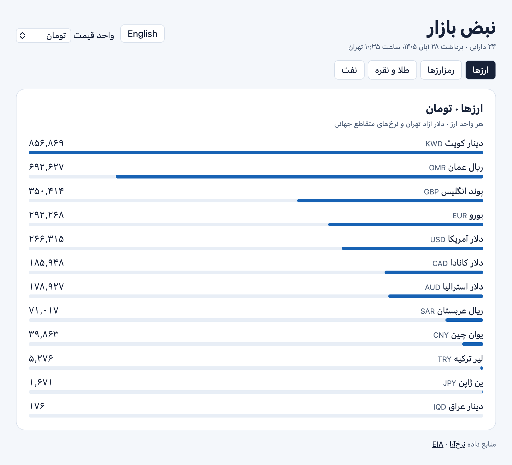
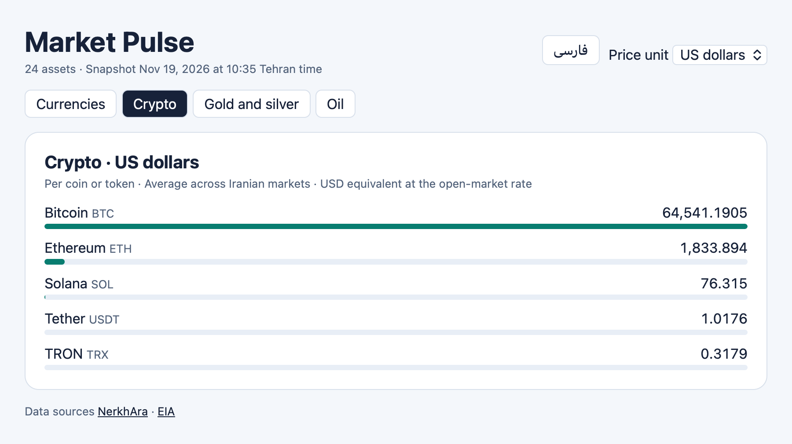

# Codex Chand | کدکس چند

Codex Chand is a bilingual Codex skill for checking Tehran open-market exchange rates, cryptocurrencies, Iranian gold coins, metals, and energy benchmarks. Ask for one asset to get a one-line quote in toman and US dollars, or invoke the skill by itself to see the full watchlist. Add a date range to explore price history and technical indicators.

## Dashboard screenshots

These screenshots show the November 19, 2026 dashboard. The current template includes 42 rows in five categories.

### Persian · Exchange rates in toman



### English · Crypto in US dollars



## Install

Clone the repository into your Codex skills directory.

```sh
mkdir -p ~/.codex/skills
git clone https://github.com/prp-e/codex-chand.git ~/.codex/skills/codex-chand
```

If you already have a `codex-chand` folder, review or back up your local copy before updating it. Keep the source notes and the `assets` folder beside `SKILL.md` so the skill can resolve its relative links. If Codex does not list the skill immediately, restart the session.

## Usage

| Prompt | Result |
| --- | --- |
| `$codex-chand` | Full bilingual dashboard with Persian and toman selected by default |
| `$codex-chand USD` | Tehran open-market price for one US dollar in toman |
| `$codex-chand BTC` | One Bitcoin quote in toman and US dollars |
| `$codex-chand طلای ۱۸ عیار` | Iranian 18-karat gold price per gram in toman and US dollars |
| `$codex-chand سکه امامی` | Iranian Emami gold coin price per coin in toman and US dollars |
| `$codex-chand Brent` | Brent spot price per barrel with the observation date when delayed |
| `$codex-chand بیت‌کوین، ۱۸۰ روز اخیر به تومان، با RSI` | Bitcoin history in toman with RSI selected |

Single-asset replies use the language of the request. In the dashboard, switch between Persian and English or between toman and US dollars. The language toggle updates labels, dates, number formatting, and reading direction while preserving the selected category and currency.

## Historical charts

1. Click an asset name in the interactive Codex dashboard. A settings form opens directly below that asset.
2. Select a date range, currency, chart type, and indicator. The form starts with 90 days and the dashboard's current currency.
3. Select **Show chart and analysis** and confirm the follow-up in Codex. The form closes, and Codex displays the chart and written technical analysis using your selections where data is available.

The result keeps the selected settings and includes an observation scrubber. The analysis covers trend, drawdown, moving averages, RSI, and potential support and resistance backed by dated observations. You can also request an interactive chart in chat by typing an asset and a date range. Use a direct request for custom start and end dates.

- **Ranges** — 7, 14, 30, 60, 90, or 180 days, 1, 2, or 5 years, year to date, all available data, or custom start and end dates. Coverage depends on the source and asset.
- **Chart types** — Line charts for sampled prices or averages. Candles are available when the series has verified open, high, low, and close values.
- **Indicators** — 20- and 50-period simple moving averages and 14-period Wilder RSI with 30 and 70 reference levels.
- **Range statistics** — Return, high and low, drawdown from the period high, and maximum peak-to-trough drawdown.
- **Historical currency conversion** — Toman and USD views use verified exchange rates from matching historical dates or periods when conversion data is available.

## Supported assets

The dashboard includes 42 default quotes. Dubai crude is available on request as a monthly benchmark.

| Category | Asset or benchmark | Quote basis | Availability |
| --- | --- | --- | --- |
| Fiat | US dollar (`USD`) | 1 currency unit | Default |
| Fiat | Canadian dollar (`CAD`) | 1 currency unit | Default |
| Fiat | Australian dollar (`AUD`) | 1 currency unit | Default |
| Fiat | Euro (`EUR`) | 1 currency unit | Default |
| Fiat | British pound (`GBP`) | 1 currency unit | Default |
| Fiat | Omani rial (`OMR`) | 1 currency unit | Default |
| Fiat | Turkish lira (`TRY`) | 1 currency unit | Default |
| Fiat | Saudi riyal (`SAR`) | 1 currency unit | Default |
| Fiat | Iraqi dinar (`IQD`) | 1 currency unit | Default |
| Fiat | Kuwaiti dinar (`KWD`) | 1 currency unit | Default |
| Fiat | Chinese yuan (`CNY`) | 1 currency unit | Default |
| Fiat | Japanese yen (`JPY`) | 1 currency unit | Default |
| Fiat | UAE dirham (`AED`) | 1 currency unit | Default |
| Fiat | Swiss franc (`CHF`) | 1 currency unit | Default |
| Crypto | Bitcoin (`BTC`) | 1 coin or token | Default |
| Crypto | Ethereum (`ETH`) | 1 coin or token | Default |
| Crypto | Tether (`USDT`) | 1 coin or token | Default |
| Crypto | Solana (`SOL`) | 1 coin or token | Default |
| Crypto | TRON (`TRX`) | 1 coin or token | Default |
| Crypto | XRP (`XRP`) | 1 coin or token | Default |
| Crypto | BNB (`BNB`) | 1 coin or token | Default |
| Crypto | Dogecoin (`DOGE`) | 1 coin or token | Default |
| Crypto | PAX Gold (`PAXG`) | 1 coin or token | Default |
| Metals | World gold (`XAU`) | 1 troy ounce | Default |
| Metals | World silver (`XAG`) | 1 troy ounce | Default |
| Metals | Platinum (`XPT`) | 1 troy ounce | Default |
| Metals | Palladium (`XPD`) | 1 troy ounce | Default |
| Metals | World pure gold | 1 gram | Default |
| Metals | Iranian 18K gold | 1 gram | Default |
| Metals | Iranian 24K gold | 1 gram | Default |
| Metals | Iranian melted gold | 1 mesghal | Default |
| Metals | Copper | 1 metric ton (monthly average) | Default |
| Metals | Aluminum | 1 metric ton (monthly average) | Default |
| Iranian gold coins | Emami coin | 1 coin | Default |
| Iranian gold coins | Bahar Azadi coin | 1 coin | Default |
| Iranian gold coins | Half coin | 1 coin | Default |
| Iranian gold coins | Quarter coin | 1 coin | Default |
| Iranian gold coins | One-gram coin | 1 coin | Default |
| Energy | Brent spot crude | 1 barrel | Default |
| Energy | WTI spot crude | 1 barrel | Default |
| Energy | OPEC Reference Basket | 1 barrel | Default |
| Energy | Henry Hub spot natural gas | 1 million BTU | Default |
| Energy | Dubai crude | 1 barrel (monthly average) | On request |

## Data and conversions

- **Fiat and local markets.** The skill uses Tehran open-market USD for currency conversion and distinguishes direct quotes from derived cross rates. Local cryptocurrency prices can differ from international prices, including for USDT.
- **Currency units.** One toman equals ten Iranian rials. Quotes published per 100 units are normalized to a single unit. The dashboard uses one verified Tehran USD rate per snapshot for derived equivalents.
- **Metals.** World pure gold per gram is derived using 31.1034768 grams per troy ounce. Iranian 18K and 24K gold use local per-gram quotes.
- **Freshness.** Codex checks sources when invoked. Delayed benchmarks retain their own observation dates. Monthly averages show the observation month. If a fresh quote cannot be verified, the skill shows a dated fallback or marks the quote unavailable.

The source notes document providers, quote units, timestamps, and alternatives. Availability depends on Codex's network access and the providers. Some optional sources require credentials. Keep credentials out of the dashboard HTML and repository. [Market data sources](sources.md)

## Repository contents

| File | Purpose |
| --- | --- |
| [SKILL.md](SKILL.md) | Invocation behavior, watchlist, display rules, and conversion logic |
| [history.md](history.md) | Historical data selection, chart controls, and technical analysis |
| [assets/history.html](assets/history.html) | Interactive historical chart template |
| [sources.md](sources.md) | Provider documentation and guidance on selecting and validating observations |
| [assets/market-prices.html](assets/market-prices.html) | Interactive dashboard fragment containing a dated 42-row example checked on November 21, 2026 |

The template shows an embedded snapshot. To refresh it, Codex replaces the observations, dates in both languages, captions, and source links. For a standalone browser export, ask Codex to wrap the fragment in a complete HTML document and supply the hosting styles and theme variables it needs.
